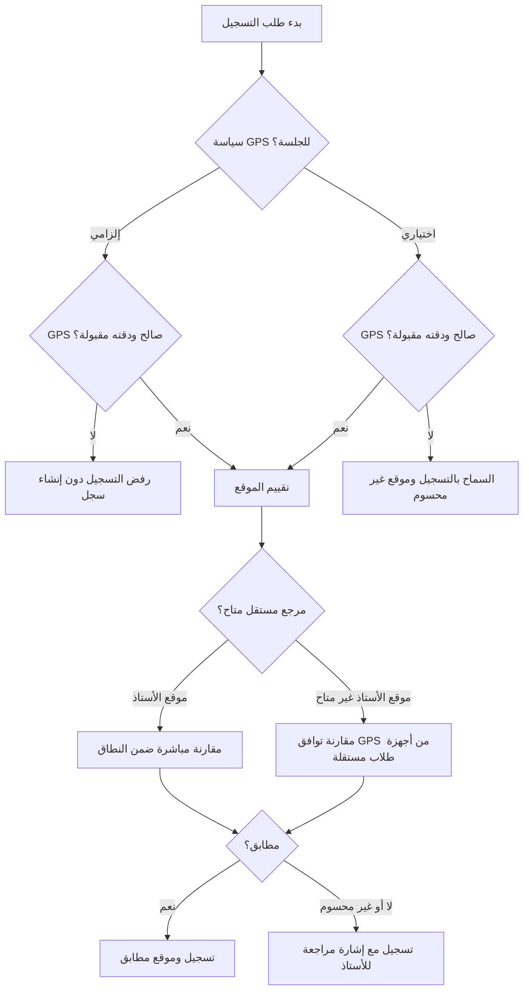

# هرمية التحقق من موقع الطالب

## سياسة GPS التي يختارها الأستاذ قبل بدء الجلسة

| المسار | عند غياب GPS صالح من هاتف الطالب | عند توفر GPS صالح |
|---|---|---|
| GPS إلزامي | يُرفض التسجيل ولا يُنشأ سجل حضور. | يُسجل الطلب وتُقارن الإحداثيات بمرجع الموقع. |
| التسجيل مسموح دون GPS | يُسمح بالتسجيل، وتكون نتيجة الموقع غير محسومة وتحتاج مراجعة. | يُسجل الطلب ويُستخدم GPS للتحقق من الموقع. |

## قواعد التفسير

1. يُعد GPS صالحًا إذا أرسله المتصفح وكانت دقته ضمن الحد المقبول للجلسة: `min(250 مترًا، نطاق المقارنة)`.
2. في المسارين، اختلاف موقع GPS عن النطاق لا يرفض الطلب تلقائيًا؛ يُسجل الحضور وتظهر نتيجة الموقع للأستاذ للمراجعة.
3. عند غياب GPS في المسار الاختياري، يمكن مقارنة منطقة IP التقريبية ومؤشرات الشبكة بمراجع الجلسة أو المجموعة. هذه مؤشرات مساعدة، ولا تثبت وجود الطالب داخل القاعة.
4. مواقع الطلاب لا تصبح مرجعًا جماعيًا إلا من أجهزة مستقلة. قبل توافر مرجع كافٍ تبقى النتيجة معلقة أو غير محسومة.
5. حالة الحضور، مثل حاضر أو متأخر، مستقلة عن نتيجة التحقق من الموقع.
6. قيم السياسات القديمة في الجلسات القائمة تبقى مدعومة حتى لا تتغير دلالات الجلسات السابقة.
