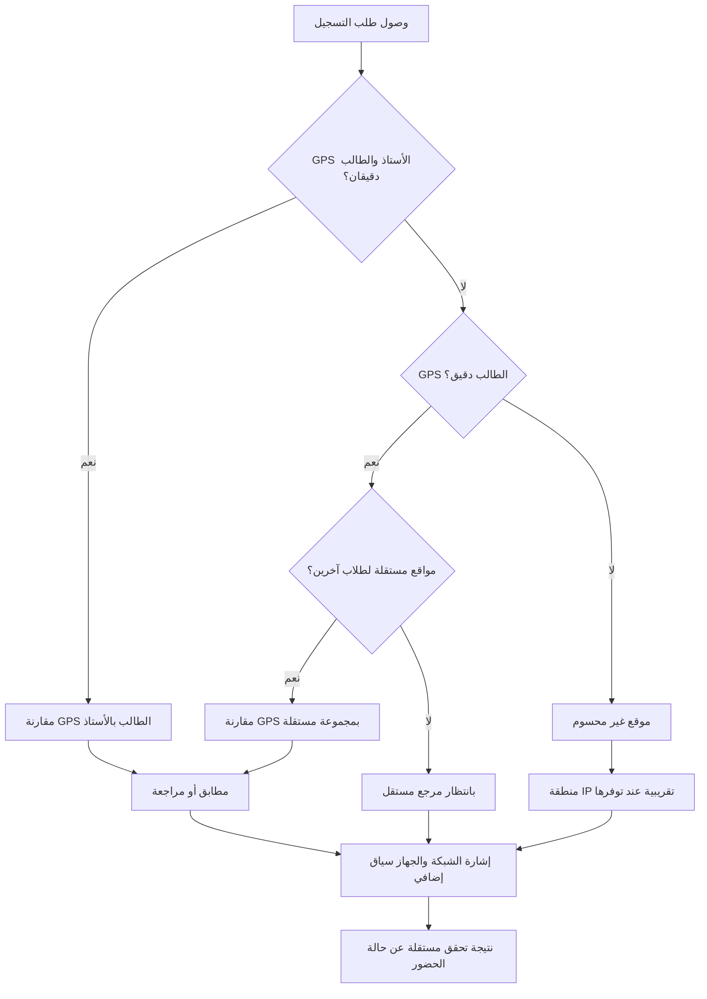

# هرمية التحقق من موقع الطالب

يُحسب حاضر/متأخر من وقت التسجيل، وتُعرض نتيجة الموقع مستقلة عنه. لا يثبت تشابه عنوان الاتصال وجود الطالب داخل القاعة.

1. GPS الطالب والأستاذ الدقيقان هما المرجع المباشر؛ خارج النطاق يستلزم المراجعة ولو تشابه نطاق IP.
2. عند غياب GPS الأستاذ، يقارن GPS الطالب الدقيق بمجموعة طلاب على أجهزة مستقلة؛ لا تحل منطقة IP التقريبية محل GPS الدقيق.
3. عند غياب GPS الطالب أو انخفاض دقته، تكون النتيجة غير محسومة وتحتاج مراجعة، حتى لو تشابه نطاق عناوين الاتصال.
4. منطقة IP تقريبية وقد تكشف تعارضًا واسعًا، لكنها لا تثبت الوجود داخل القاعة. تشابه نطاق IP وصف لاتصال الطلبات فقط.
5. مشاركة الجهاز تضاف كتنبيه مستقل، ويستبعد تكرار الجهاز عند تكوين مرجع المجموعة.
6. عدم وصول الطلب إلى الخادم يعني عدم وجود تسجيل قابل للتقييم.

السياسة `review` تقبل التسجيل مع تنبيه؛ السياسة `block` تبقي شروط رفض التسجيل القائمة. لا تعدل إشارة الموقع حالة حاضر/متأخر تلقائيًا.
